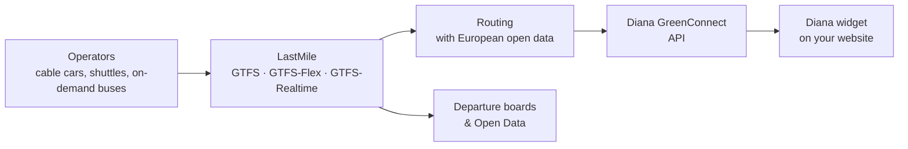

  

  <h3>smart. green. connect.</h3>
  
Journey planning by public transport, from the front door to the very last mile.

  

    <a href="https://zuugle-services.com/"><strong>Website</strong></a> ·
    <a href="https://zuugle-services.com/diana/"><strong>Diana GreenConnect</strong></a> ·
    <a href="https://lastmile.zuugle-services.com/"><strong>LastMile</strong></a> ·
    <a href="mailto:office@zuugle-services.com"><strong>Contact</strong></a>
  

---

## 👋 About us

We are **Zuugle Services**, a company in Vienna building the technology that makes car-free travel the easy choice.

Guests are happy to take the train, until the journey planner stops at the station. The shuttle to the hotel, the cable car up the mountain, the bus back after the concert: they are often missing, so the whole trip looks impossible without a car. We close that gap.

Our roots are in the non-profit project [Bahn zum Berg](https://www.bahn-zum-berg.at) (*train to the mountain*). Building on that experience, we offer the same idea commercially to tourism businesses, event organisers, hotels, regions and transport operators.

---

## 🚀 What we build

| | Product | What it does | For |
| --- | --- | --- | --- |
| 🗺️ | **[Diana GreenConnect](https://zuugle-services.com/diana/)** | Plans the whole journey to an activity and back: from any address, by train and bus, respecting start time, end time and duration. Embeddable as a widget. | Event organisers, tourism, ski areas, hotels |
| 🚠 | **[LastMile](https://lastmile.zuugle-services.com/)** | Keeps the timetables that journey planners miss (cable cars, shuttles, hiking and ski buses, on-demand services) and publishes them as open standards, with realtime status. | Operators, hotels, tourism regions |
| 📍 | **[Diana MultiConnect](https://zuugle-services.com/multiconnect/)** | Calculates public-transport reachability for many places at once: hotels, points of interest, tours, events. | Tourism portals, accommodation platforms |

### How it fits together

---

## 🧩 Diana GreenConnect Widget (open source)

The **Diana GreenConnect Widget** brings personal journey planning to any website. Visitors enter where they start and get a plan that fits the times of your activity, there and back.

  

- **🕒 Built around your activity:** respects the earliest start, the latest end and the duration, including multi-day stays.
- **🚪 Door to door:** includes the last mile, from shuttles to cable cars, wherever the data exists.
- **🇪🇺 Cross-border:** Austria, Germany, Switzerland, Liechtenstein, Italy, France, Czech Republic, Slovakia, Hungary and Slovenia.
- **🔌 Easy to embed:** a JavaScript snippet or a WordPress block.
- **🔐 Secure by design:** OAuth 2.0. Your backend gets the access token, and the client secret never reaches the browser.

### Repositories

| Repository | What's inside |
| --- | --- |
| [**DianaWidget**](https://github.com/zuugle-services/DianaWidget) | The embeddable JavaScript widget: configuration, theming and the secure token flow. |
| [**wp-diana-widget**](https://github.com/zuugle-services/wp-diana-widget) | WordPress plugin that adds the widget as a Gutenberg block. |

To use the widget you need API access - Interested? Write to [office@zuugle-services.com](mailto:office@zuugle-services.com).

---

## 🌱 What we believe in

- **Open standards, no lock-in.** Timetables go out as GTFS, GTFS-Flex and GTFS-Realtime. The data belongs to the operator.
- **Correct beats complete.** Every timetable is validated before it is published. AI suggests changes, a person approves them.

---

## 📬 Contact

- **Email:** [office@zuugle-services.com](mailto:office@zuugle-services.com)
- **Website:** [zuugle-services.com](https://zuugle-services.com/)
- **LastMile:** [lastmile.zuugle-services.com](https://lastmile.zuugle-services.com/)

  
<strong>Legal notice (Impressum)</strong>

  

    <strong>Zuugle Services GmbH</strong> 
    Sankt-Johann-Gasse 18/10 
    1050 Vienna, Austria 
    Commercial Register Court Vienna: FN 610812 d 
    VAT ID: ATU79853525 
    European Commission PIC: 880412838
  

